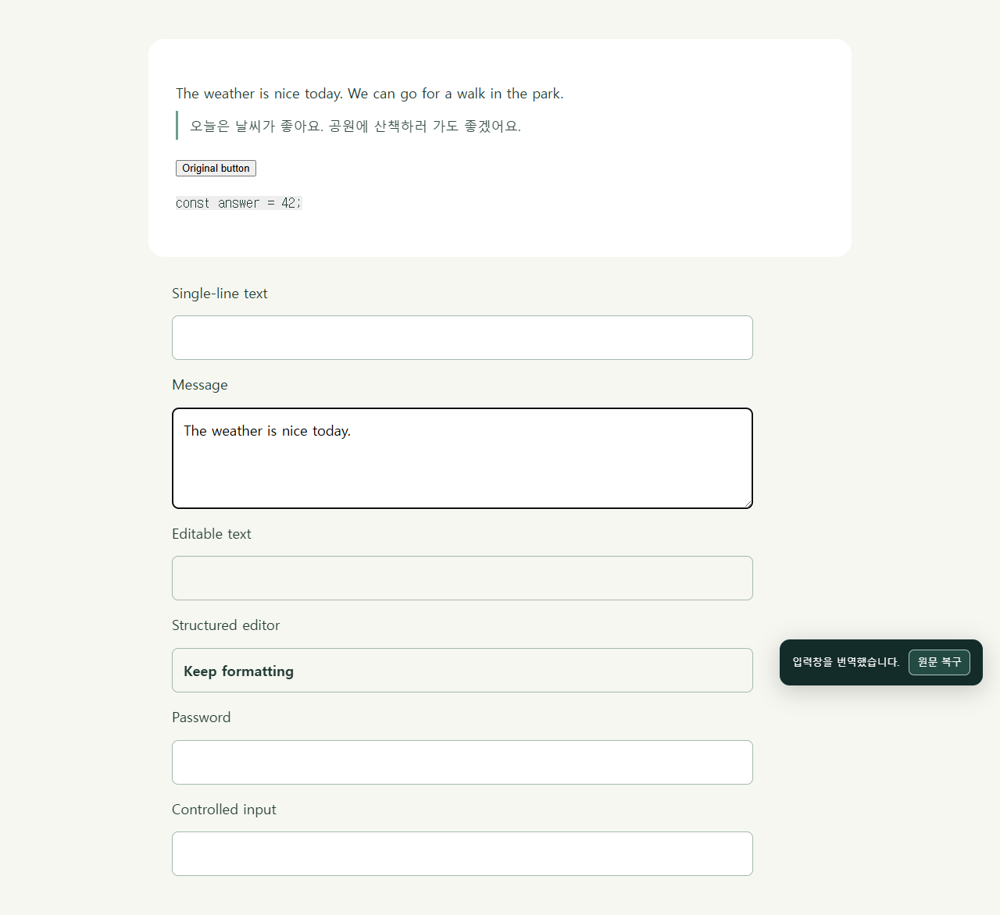

# Translate AI

웹페이지는 **원문과 한국어를 함께**, 입력한 문장은 **스페이스바 3회로 바로 번역**하는 Chrome/Edge Manifest V3 확장 프로그램입니다.

**v1.1.0: 내 ChatGPT 계정 로그인으로 번역합니다.** 이 PC에서 실행하는 공식 Codex CLI가 로그인을 처리하며 별도 OpenAI API 키가 필요하지 않습니다. 기존 무료 번역·개인 API 방식도 선택할 수 있습니다.



## 설치

1. [릴리스](https://github.com/Choi-sungjin/Translate-AI/releases)에서 **`Translate-AI-1.1.0-desktop.zip`** 전체 패키지를 내려받아 압축을 풉니다. 또는 이 저장소를 복제합니다.
2. Chrome 주소창에 `chrome://extensions`를 입력하고 **개발자 모드**를 켭니다.
3. **압축해제된 확장 프로그램을 로드합니다**를 누르고 **`extension` 폴더**를 선택합니다. 확장만 들어 있는 `Translate-AI-1.1.0.zip`을 푼 경우에는 `manifest.json`이 있는 폴더를 선택합니다.
4. 기존 웹페이지를 새로고침하고 툴바에서 Translate AI를 고정합니다.

확장 자체는 빌드 과정 없이 로드할 수 있습니다. ChatGPT 로그인 번역에는 아래 로컬 연결 프로그램이 필요합니다. Chrome 웹 스토어에 게시한 제품은 아닙니다.

### ChatGPT 계정 연결

1. **Node.js 22 이상**을 설치합니다. Windows에서 전체 패키지의 **`Start-Translate-AI.cmd`**를 실행합니다. 최초 실행 시 공식 Codex CLI 의존성을 설치하고, 이후 로컬 연결 프로그램을 백그라운드로 실행합니다.
2. 열리는 연결 화면에서 로그인 상태를 확인합니다. 기존 Codex의 ChatGPT 로그인을 재사용합니다. 로그인이 필요하다면 이 프로젝트 폴더에서 **`npx codex login`**을 실행하고 공식 브라우저 로그인을 직접 완료합니다.
3. 연결 화면의 **로컬 연결 코드**를 복사합니다. 확장 설정 → **ChatGPT 계정 로그인** → **로컬 연결 코드**에 붙여넣고 저장합니다.
4. **저장한 연결 상태 확인**, **저장한 설정으로 연결 확인**으로 확인합니다. 기존 v1.0 사용자는 확장을 새로고침한 뒤 서비스를 직접 ChatGPT로 바꾸세요.

이 코드는 이 PC의 확장과 로컬 프로그램 사이의 연결 코드입니다. ChatGPT OAuth 토큰이나 API 키가 아니며 다른 사람과 공유하지 마세요. 계정 로그인 정보는 공식 CLI 저장소에 그대로 남습니다. 브라우저 쿠키나 OAuth 토큰을 확장으로 복사하지 않습니다.

`Start-Translate-AI.cmd`는 Windows 로그인 시 자동 실행하도록 등록하지 않습니다. PC 재부팅 후 다시 실행해야 합니다. 종료하려면 **`Stop-Translate-AI.cmd`**를 사용합니다. PowerShell 스크립트 실행이 제한된 환경이나 다른 운영체제에서는 터미널에서 `npm ci`, `npm run bridge`를 실행하고 `http://127.0.0.1:18458/`을 직접 여세요. 이 경우 종료는 해당 터미널에서 Ctrl+C입니다.

## 사용

| 기능 | 조작 |
|---|---|
| 원문·번역 병기 | 확장 아이콘 → **이 페이지 번역하기**, 또는 **Alt+A** |
| 원문만 보기 | 같은 버튼이나 **Alt+A**를 다시 누르기 |
| 입력창 번역 | 문장을 쓴 뒤 **Space를 빠르게 3회**, 또는 **Alt+I** |
| 입력 원문 복구 | 번역 직후 알림의 **원문 복구** 버튼 |
| 언어·번역 서비스 | 확장 아이콘 → **언어 · 번역 서비스 설정** |

- 기본값: 웹페이지는 **한국어**, 입력창은 **영어**. 각각 따로 변경할 수 있습니다.
- Space 연타 간격 기본 300ms, 설정에서 200/300/500ms를 선택합니다. 길게 누르기는 연타로 계산하지 않습니다.
- 원문 노드·링크·강조·이벤트를 유지하고 별도 번역문을 추가합니다. 화면 가까이 있는 문단부터 번역하고 동적으로 추가된 문단도 처리합니다.
- 번역을 기다리며 새 글을 쓰면 오래된 결과로 덮어쓰지 않습니다. 자동으로 Enter를 누르거나 메시지를 전송하지 않습니다.
- 원문 복구 알림은 약 10초 동안 표시됩니다. 적용 후 내용을 바꿨다면 복구로 덮어쓰지 않습니다. 브라우저 기본 Undo 지원은 보장하지 않습니다.

## 번역 서비스

**ChatGPT 계정 로그인**이 새 설치의 기본값입니다. 공식 Codex CLI 0.162.1의 저장된 ChatGPT 인증으로 `codex exec`를 실행합니다. 별도 API 결제 키를 사용하지 않으며 **계정의 Codex 이용 한도**가 적용됩니다. 일반 API보다 느릴 수 있고, 문단마다 요청하므로 긴 문서는 사용량이 커집니다. 요청은 로컬 프로그램에서 순차 처리하며 원문·프롬프트를 자체 로그에 남기지 않습니다. 개인 번역 용도의 로컬 연결이며 공개 API 서버로 배포하지 마세요.

로컬 연결은 `127.0.0.1:18458`에서만 수신합니다. 연결 코드를 검증하며 외부 웹 Origin을 거부합니다. Codex 실행은 읽기 전용 샌드박스, 사용자 설정 미로딩, 도구·앱·MCP·브라우저·메모리 기능 비활성화, 전용 번역 지침을 사용합니다. CLI 계정 인증은 계속 공식 CLI가 담당합니다. 회사 관리 정책이 기능을 제한하면 해당 제한을 우회하지 않습니다.

**MyMemory 무료 API**도 설정에서 선택할 수 있습니다. 익명 사용에는 일일 한도가 있고, 품질은 문장과 언어에 따라 달라집니다. ChatGPT 오류가 나더라도 다른 서비스로 자동 전송하지 않습니다.

개인 AI API는 OpenAI 호환 `chat/completions` 규격을 지원합니다. 설정에서 전체 API 주소, 모델 이름, 필요한 경우 API 키를 입력하고 저장한 뒤 **저장한 설정으로 연결 확인**을 누릅니다. 로컬 서버는 `http://127.0.0.1:포트/v1/chat/completions` 등의 주소를 사용할 수 있습니다. 외부 서버는 HTTPS만 허용합니다. 실제 개인 API 서비스·로컬 모델은 사용자가 별도로 준비해야 합니다.

개인 API 프로토콜은 로컬 테스트 서버로 검증했으며 모든 공급자·모델과의 호환성을 뜻하지 않습니다. Gemini 계정 로그인은 이 버전에 구현하지 않았습니다.

## 지원 범위

- HTTP/HTTPS 일반 웹페이지, 텍스트/검색 input, textarea, 텍스트 노드만 있는 단순 contenteditable.
- 복잡한 서식 편집기(Gmail·Notion 등), 닫힌 Shadow DOM, 브라우저 내부 페이지, 웹 스토어, PDF·자막 번역은 현재 지원 범위에 포함하지 않습니다.
- 입력 번역 최대 12,000자. 페이지당 최대 1,000개 문단을 추적하며 12,000자를 넘는 단일 문단은 건너뜁니다.
- 한국어 IME 조합 중 트리거 방지는 이벤트 시뮬레이션으로 검사했습니다. 실제 Windows IME 키 입력, 모든 사이트의 편집기 호환성을 검증한 것은 아닙니다.

## 개인정보와 권한

번역 버튼이나 입력 번역 단축키를 실행하면 대상 텍스트가 선택한 번역 서비스로 전송됩니다. ChatGPT 방식은 로컬 연결 프로그램 → 공식 CLI → OpenAI 순서로 전송됩니다. API 키·로컬 연결 코드는 이 브라우저의 확장 로컬 저장소에 저장되며 웹페이지에 전달하지 않고, 동기화하지 않습니다. 이 저장소는 비밀 보관소 수준의 암호화를 제공하는 것은 아닙니다. 로컬 연결 코드는 사용자 앱 데이터의 `Translate-AI/bridge-state.json`에 저장됩니다. OAuth 인증·서버 보관 정책은 공식 서비스의 정책을 따릅니다.

HTTP/HTTPS 사이트 접근 권한은 문단 읽기·번역문 표시·입력 단축키와 설정한 번역 서버 호출에 사용합니다. 비밀번호 필드는 제외합니다. 확장 자체는 계정·분석용 추적·사용 이력 수집 기능이 없습니다. 번역 캐시는 메모리에만 보관합니다. 서버로 보낸 텍스트의 보관 정책은 해당 번역 공급자의 정책을 따릅니다.

## 개발과 검증

Node.js 22 이상 권장:

```sh
npm ci
npx playwright install chromium
npm run check
npm test
npm run package
```

- `npm run test:regression`: 실제 확장을 로드한 Chrome for Testing + 결정적인 로컬 API 응답으로 회귀 동작 검사.
- `npm run test:live`: 실제 MyMemory API, 공개 사이트, 입력창 번역 검사. 네트워크 연결과 무료 서비스의 잔여 한도가 필요합니다.
- `npm run test:login`: 실행 중인 로컬 연결 프로그램과 기존 ChatGPT 로그인으로 실제 확장 번역을 시험. 계정 사용량을 소비합니다.
- `npm test`: 텍스트·로컬 연결 보안 시험 + 회귀·무료 API 브라우저 시험. ChatGPT 로그인 시험은 별도입니다.
- `npm run package`: `dist/Translate-AI-1.1.0.zip`(확장만), `dist/Translate-AI-1.1.0-desktop.zip`(전체 소스·로컬 연결), SHA-256 생성. 사용자 설정·키·브라우저 프로필·node_modules는 포함하지 않습니다.

검증 범위와 실제 번역 예문: [ChatGPT 로그인 검증 보고서](docs/CHATGPT-LOGIN.md), [v1.0 검증 보고서](docs/VERIFICATION.md). 설정 화면: [스크린샷](docs/screenshots/chatgpt-settings.png).

## REA와의 관계

REA는 원본 배포물의 동작 구조를 이해하는 분석 도구로 사용했습니다. 이 확장은 독립적으로 작성했으며 Immersive Translate의 코드·브랜드 자산을 포함하지 않습니다. 실행 시 REA 설치가 필요하지 않습니다. REA의 Codex 연결과 이번 분석 범위는 [REA 메모](docs/REA.md)에 기록했습니다.
