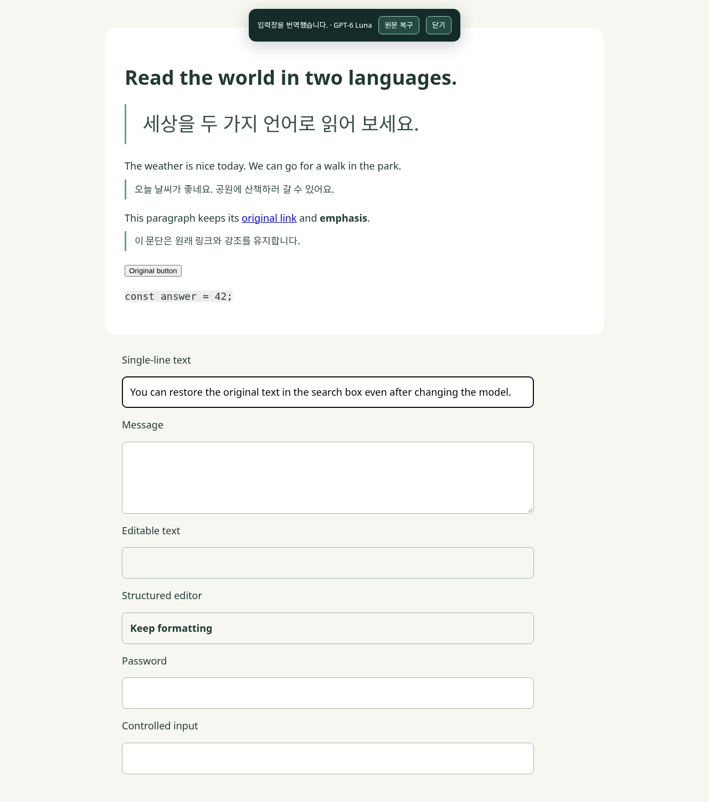

# Translate AI 1.4.0 검증

검증일: 2026-10-19. Ubuntu 24.04.5 x64 / X11 / Node.js 24.19.0.

## 실행 결과

| 검사 | 명령 | 결과 |
|---|---|---|
| 문법과 확장 구성 | `npm run check` | 27개 JavaScript 파일, 확장 필수 파일 확인 |
| 단위·보안·종료 처리 | `npm run test:unit` | 21 passed |
| 브라우저 회귀 | `npm run test:regression` | 25 passed |
| Linux 실행 | `npm run test:linux` | 실제 프로세스 통합 검사 1 passed (중복·공백 경로·다른 폴더·포트 충돌·반복 종료 포함) |
| 실제 ChatGPT 로그인 | `npm run test:login -- --grep "selecting each Luna|LOGIN SETUP|ChatGPT OAuth"` | 3 passed, Sol 및 Luna 2종 |
| 실제 무료 서비스 | `npm run test:live` | 1 passed |
| 배포 파일 구성·체크섬 | `npm run package && npm run test:package` | 3개 ZIP, 1 passed |

브라우저 검사 환경은 별도 Chrome for Testing 156.0.8078.4입니다. 사용자의 기존 Chrome 프로필 설치와 구분합니다.

실제 무료 서비스 입력: `오늘 날씨가 좋습니다.` → `The weather is nice today.`. 문단의 원문·한국어 병기와 공개 example.com 번역도 확인했습니다. 무료 서비스를 별도로 선택한 검사이며 ChatGPT 오류에 대한 자동 대체가 아닙니다.

## 검증 범위

- 독립 코드 검토: 최종 PASS. 종료 상태 확인 직후 요청이 들어오는 경우와 종료 재시도를 보완했습니다. 코드 검토 결과를 실제 실행 증거로 사용하지 않습니다.
- Windows 실제 사용자 데스크톱, Linux Wayland 및 arm64, 재부팅 후 동작은 이 PC에서 검증하지 않았습니다.
- 자동 로그인 시작은 등록하지 않습니다. 재부팅 후 앱 메뉴나 시작 파일로 실행합니다.
- Chrome 내부 확장 설치 화면은 자동 조작 도구가 차단하므로 기존 사용자 프로필의 확장 설치는 사용자가 진행합니다.

## Linux 배포본 설치

`Translate-AI-1.4.0-linux.zip`을 공백이 있는 새 임시 폴더에 압축 해제하고 `node_modules`가 없는 상태에서 시작했습니다. 잠금 파일의 생산 의존성 2개가 자동 설치됐고, `/health`에서 `version=1.4.0`, `modelSelection=true`, `pageBatchTransport=true`를 확인했습니다. 실제 Codex CLI 0.162.1 실행과 저장된 ChatGPT 로그인 확인, 종료에 통과했습니다.

앱 메뉴 파일은 `desktop-file-validate`를 통과했습니다. 등록된 실행 파일은 `PATH=/usr/bin:/bin` 환경에서도 정상 시작했습니다. 이는 메뉴 항목 구성과 실행 파일 검증이며 GNOME 메뉴를 실제 클릭한 검사는 아닙니다. 연결 코드 파일 권한은 600, 데이터 디렉터리는 700이었습니다.

## 실제 ChatGPT 번역

GPT-6 Luna와 GPT-5.6 Luna 각각 문단 한국어 번역, 입력 영어 번역, 입력 원문 복구와 페이지 원문 복구에 통과했습니다. 두 모델 모두 입력 `모델을 변경한 뒤에도 검색창의 원문을 복구할 수 있습니다.`를 `You can restore the original text in the search box even after changing the model.`로 번역했습니다.

## Windows 검사

[GitHub Actions](https://github.com/Choi-sungjin/Translate-AI/actions/workflows/test.yml)의 `windows-launcher` 작업은 Windows 환경에서 Codex 실행 파일 버전 확인, 단위 검사, 기존 PowerShell 실행 스크립트 12개 모의 시나리오, ZIP 생성을 실행합니다. Windows 사용자 데스크톱에서 로그인과 실제 번역을 재검증한 것으로 해석하면 안 됩니다.
